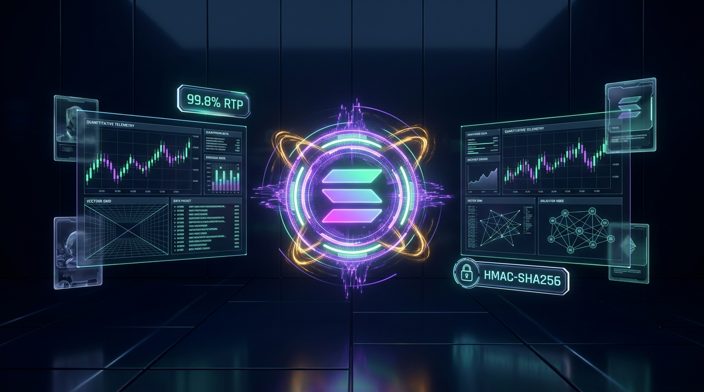

# ⚡ Solana High-Frequency Gacha Protocol — Quant & Bot Starter Kit



[](https://explorer.solana.com/address/3u6pHbfXqiDJLMxpLtXvUxGiC1Twwo2v9aaHBxo839GM)
[](https://gacha-protocol-628421927095.us-central1.run.app)
[](https://gacha-protocol-628421927095.us-central1.run.app/bots.html)

Official starter kit and API specification for algorithmic trading bots, high-frequency quant snipers, and automated players on the **Solana High-Frequency Gacha Protocol**.

---

## 🎯 Protocol Overview

The protocol is an ultra-low latency, micro-friction Provably Fair card-pack opening system with a shared on-chain progressive jackpot.

- **Theoretical RTP**: **99.8%** (House friction: **0.2%**)
- **Target Roll for Jackpot**: **`777`** (Range: `0` to `999`, exact 1 in 1,000 odds)
- **RNG Mechanism**: Cryptographic **HMAC-SHA256** (Provably Fair)
- **Settlement**: Instant on-chain Solana deposits & withdrawals
- **WebSocket Protocol**: Sub-10ms response time hosted on Google Cloud Run

### Multi-Tier Hit System & Paytable

The protocol features a 3-tier continuous reward distribution so automated bots and algorithms hit frequent profitable bursts while hunting the progressive jackpot:

| Hit Type | Odds | Trigger Condition | Payout (Bronze / Gold) |
| :--- | :---: | :---: | :--- |
| **⚡ Micro-Hit** | **1 in 25 (4.0%)** | `roll % 25 == 0` | Refund + Pot Share (Green Profit Spike!) |
| **💥 Major-Hit** | **1 in 100 (1.0%)** | `roll % 100 == 77` | Refund + 1% to 5% Pot Share |
| **🏆 Mega Jackpot** | **1 in 1,000 (0.1%)** | `roll == 777` | **10% (Bronze) or 100% (Gold) of Progressive Pot!** |
| **Standard Pack** | 94.9% | Other | Standard Refund ($0.998 / $9.980) |

---

## 📡 Endpoints & On-Chain Addresses

- **WebSocket Stream**: `wss://gacha-protocol-628421927095.us-central1.run.app/ws`
- **REST Stats API**: `https://gacha-protocol-628421927095.us-central1.run.app/api/stats`
- **Solana Mainnet Vault**: [`3u6pHbfXqiDJLMxpLtXvUxGiC1Twwo2v9aaHBxo839GM`](https://explorer.solana.com/address/3u6pHbfXqiDJLMxpLtXvUxGiC1Twwo2v9aaHBxo839GM)
- **On-Chain Beacon Tx**: [`Bz99BrEwk89RoJtDCFtRVhuFkEBLF2yShWMpVd8nbUpJCKtnQf1LmmrTcJb79b5NFdqFxhZxaPpKByKohdr3gaz`](https://explorer.solana.com/tx/Bz99BrEwk89RoJtDCFtRVhuFkEBLF2yShWMpVd8nbUpJCKtnQf1LmmrTcJb79b5NFdqFxhZxaPpKByKohdr3gaz)
- **Web UI & Telemetry**: `https://gacha-protocol-628421927095.us-central1.run.app`

---

## 🚀 Quickstart (Python Sniper Bot)

### 1. Requirements
```bash
pip install websocket-client
```

### 2. Measure Live Latency (Benchmark Mode)
Test your sub-10ms connection to Google Cloud Run without spending any funds:
```bash
python bot_sniper.py --bench
```

### 3. Run the Live Sniper Bot
```bash
python bot_sniper.py          # Snipes Bronze $1 packs (10% Pot Share)
python bot_sniper.py --gold   # Snipes Gold $10 packs (100% Pot Share)
```

---

## 🔐 Provably Fair Mathematical Verification

Each roll is cryptographically locked prior to opening. You can independently verify any roll offline:

```python
import hmac
import hashlib

def verify_roll(server_seed: str, client_seed: str, nonce: int) -> int:
    message = f"{client_seed}:{nonce}".encode('utf-8')
    key = server_seed.encode('utf-8')
    digest = hmac.new(key, message, hashlib.sha256).hexdigest()
    # Extract first 8 characters as a 32-bit unsigned integer
    int_val = int(digest[:8], 16)
    roll = int_val % 1000
    return roll

# Example verification:
# roll = verify_roll("server_seed_here", "client_seed_here", 1)
# is_jackpot = (roll == 777)
```

---

## 🤖 WebSocket Protocol Reference

### 1. Authentication / Connection
Send on connect:
```json
{
  "action": "auth",
  "playerId": "your_unique_id",
  "clientSeed": "your_custom_entropy"
}
```

### 2. Open Pack
Send to open:
```json
{
  "action": "open_pack",
  "tier": "bronze"  // or "gold"
}
```

### 3. Server Response
```json
{
  "type": "PACK_RESULT",
  "success": true,
  "playerId": "your_unique_id",
  "tier": "BRONZE",
  "roll": 27,
  "winningTarget": 777,
  "isJackpot": false,
  "payout": 0.998,
  "netChange": -0.002,
  "currentPot": 10.002,
  "balance": 9.998,
  "card": {
    "name": "Subnet Glitcher",
    "power": 30,
    "rarity": "COMMON"
  },
  "proof": {
    "serverSeedHash": "...",
    "clientSeed": "...",
    "nonce": 1,
    "hash": "..."
  }
}
```

---

## ⚖️ License
MIT License. Open-source public starter kit for developers.
